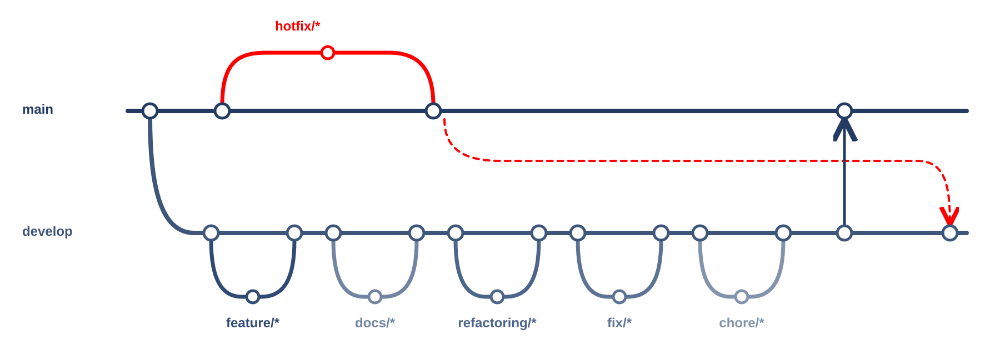

# Campus Backend

## 기술 스택

| 구분 | 기술 |
|---|---|
| 언어 | Python 3.13 이상 |
| API | FastAPI |
| 서버 | Uvicorn |
| 데이터베이스 | PostgreSQL 16 |
| DB 드라이버 | psycopg 3 |
| 캐시 | Redis 7 |

## 개발 도구

| 도구 | 용도 |
|---|---|
| uv | 패키지·가상환경 관리 |
| Docker Compose | 컨테이너 실행 환경 관리 |
| Git · GitHub | 버전 관리·협업 |
| GitHub Actions | CI |
| CodeRabbit | PR 코드 리뷰 |

SQLAlchemy와 Alembic은 의존성에 등록되어 있으나, 현재 DB 연결은 psycopg로 직접 SQL을 실행합니다.

## 브랜치와 PR



- `main`: 배포용. 일반 변경은 PR로 병합.
- `develop`: 개발 통합용.
- `feature/*`, `docs/*`, `refactoring/*`, `fix/*`, `chore/*`: `develop`에서 분기 → 작업·검증 → PR → `develop` 병합.
- 배포 준비 완료 후 `develop` → `main` PR.
- `hotfix/*`: `main`에서 분기 → 검증 → PR 없이 `main` 병합·push. 같은 수정을 `develop`에도 반영.

PR은 목적·변경·확인·배포/후속을 각각 한 줄로 적습니다. 미검증은 이유를 적고, 배포 영향이나 후속 작업이 없으면 `없음`을 적습니다.

## 처음 시작하기

준비물: [uv](https://docs.astral.sh/uv/), Docker Desktop, Git. Windows는 PowerShell에서 `.\scripts\dev.ps1 <명령>`, macOS·Linux·Git Bash는 `./scripts/dev.sh <명령>`을 씁니다.

1. `.\scripts\dev.ps1 setup` — 의존성 설치, `.env.example` → `.env` 복사(없을 때만), pre-commit 설치(`uv run pre-commit install`). `.env` 값(비밀번호 등)은 각자 채우고 커밋하지 않습니다(pre-commit이 막음).
2. `.\scripts\dev.ps1 db-up` — compose의 postgres·redis 실행(준비될 때까지 대기).
3. `.\scripts\dev.ps1 migrate` — `alembic upgrade head`.
4. `.\scripts\dev.ps1 test` — pytest. 같은 Postgres에 시험 DB(`POSTGRES_TEST_DB`)를 만들었다 지웁니다.
5. `.\scripts\dev.ps1 lint` / `format` — ruff 검사 / 자동 수정.
6. `.\scripts\dev.ps1 run` — API 실행(기본 포트 8000, `$env:PORT`로 변경). 확인: `curl http://127.0.0.1:8000/health`, 문서: `/docs`.

| 명령 | 하는 일 |
|---|---|
| `setup` | `uv sync` + `.env` 준비 + pre-commit 설치 |
| `db-up` | `docker compose up -d --wait postgres redis` |
| `migrate` | `uv run alembic upgrade head` |
| `import-release [인자]` | `scripts/import_release.py` 실행 |
| `run` | `uvicorn main:app --reload` |
| `test [인자]` | `uv run pytest` |
| `lint` / `format` | `ruff check` + `ruff format --check` / 자동 수정 |

### 지도 릴리스 가져오기·공개

campus-tracker 도로망을 draft 릴리스로 가져오고, 검증 오류가 없으면 공개합니다.

```powershell
.\scripts\dev.ps1 import-release --export <pg_dump.sql>              # draft만 생성
.\scripts\dev.ps1 import-release --api http://127.0.0.1:3210 --export <pg_dump.sql> --publish
.\scripts\dev.ps1 import-release --publish-id 3                      # 기존 draft 공개
```

공개된 릴리스는 `GET /v1/map/releases/latest`로 확인합니다.

### 줄바꿈과 코드 스타일

- 저장소는 LF로 통일합니다(`.gitattributes`, `.editorconfig`). Windows에서 생기던 CRLF 경고를 없애고 diff에 줄바꿈 변경이 섞이지 않게 하기 위함입니다. `.ps1`만 CRLF입니다.
- ruff(줄 길이 120, py313)로 검사·포맷합니다. 커밋 시 pre-commit이, PR·push 시 CI가 같은 검사를 돌립니다.
- VS Code는 추천 확장(Python, Ruff, EditorConfig)을 설치하면 저장 시 자동 포맷되고 테스트 탐색이 켜집니다.

### PR 전 확인

- [ ] `lint` 통과, `test` 통과
- [ ] 스키마를 바꿨다면 Alembic 마이그레이션 추가, `migrate`로 확인
- [ ] 새 환경 변수는 `.env.example`에 추가(값은 넣지 않음)
- [ ] 커밋 메시지는 `feat:`·`fix:`·`docs:`·`chore:` 등 접두어 + 한국어
- [ ] PR 양식(목적·변경·확인·배포/후속) 작성
